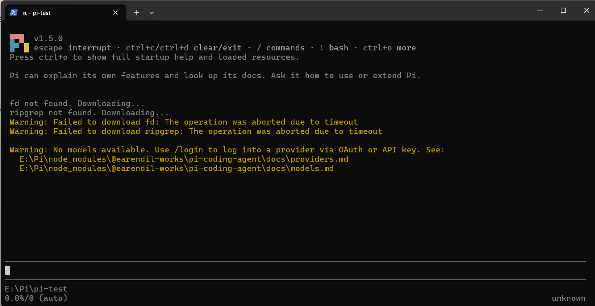
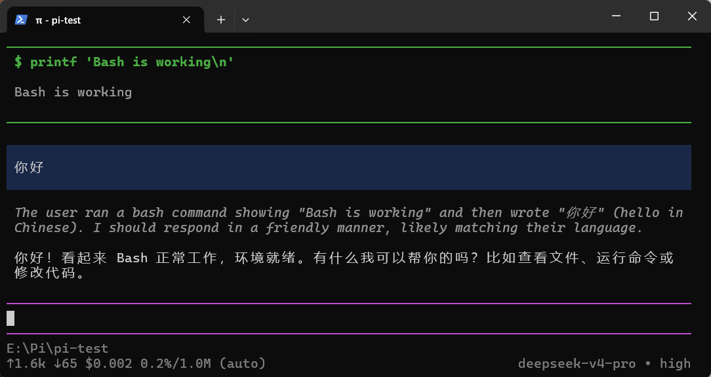
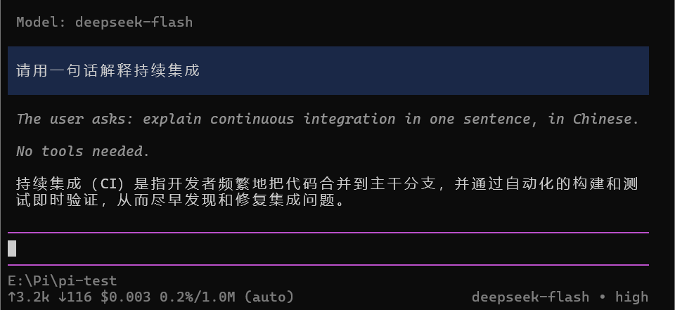
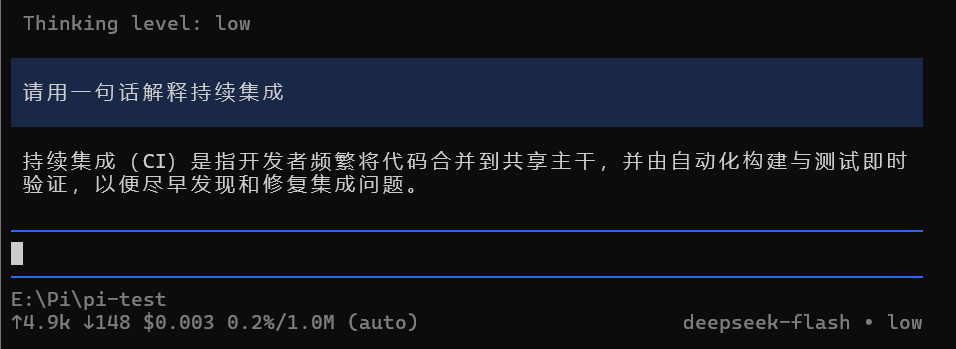
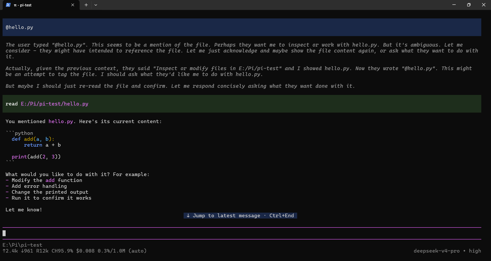
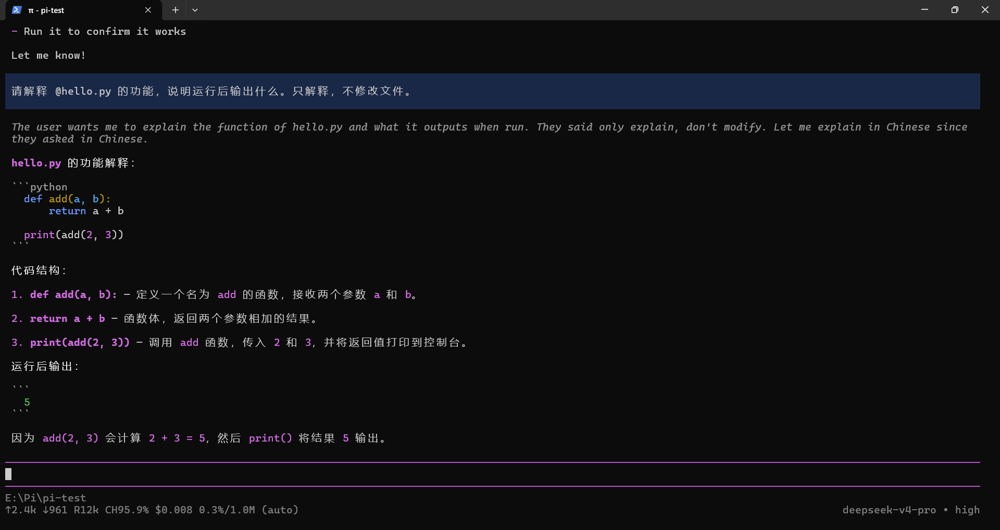
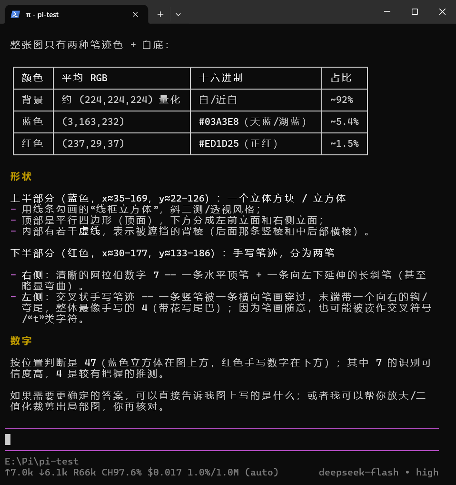
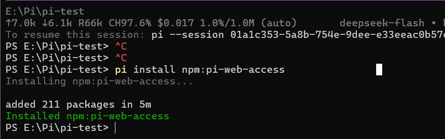
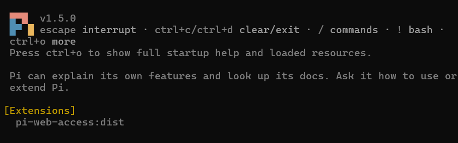
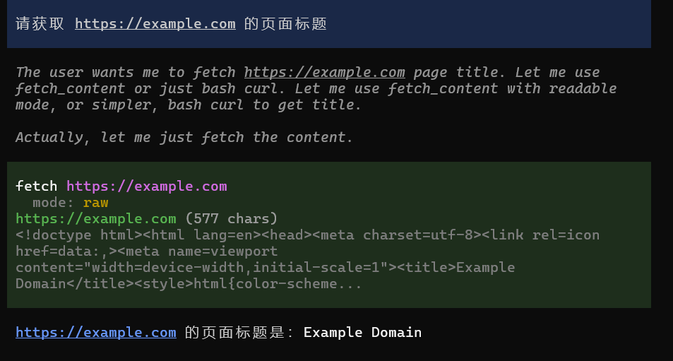

# 实践课1：Pi Agent 安装与基础使用

## 基本信息

- 姓名：魏铃峂霏
- 学号：202430071070
- GitHub 登录名：[4everik](https://github.com/4everik)

## 任务一：本地安装并启动

在 PowerShell 中执行官方安装脚本完成 Pi 客户端的安装，关闭旧终端后重新打开，在练习目录中启动 `pi`，确认版本信息和当前工作目录正常显示。

## 任务二：配置模型并完成一次会话

通过 `/login` 选择「Sign in with an API key」方式配置模型，配置成功后发送「你好」完成一次最简单会话，收到模型回复。

## 任务三：切换模型与思考级别

使用 `/thinking`（或 Shift+Tab）切换思考级别，分别记录 high 与 low 两种级别的回答状态。思考级别属于模型推理设置，不同级别对推理深度与等待时间有影响。

- 高思考级别（high）：

- 低思考级别（low）：

## 任务四：引用代码文件并粘贴小图片

### A. 使用 @ 引用代码文件

在练习目录创建 `hello.py`，输入 `@` 并在候选列表中选择 `hello.py`，再发送提示词让 Pi 解释文件功能。

Pi 正确解释了 `add` 函数并给出运行结果 5：

### B. 粘贴小图片并测试

准备一张约 200×200 像素的小图片（蓝色方块 + 数字 7），截取到剪贴板后按 Alt+V 粘贴，切换到支持图片输入的模型，发送描述请求。

测试图片：

输出结果（模型识别颜色、形状与数字）：

## 任务五：安装并使用一个插件

从 Pi Packages 自选插件（如 `pi-web-access`），使用 `pi install` 命令安装，退出原会话后重新运行 `pi`，确认插件加载并调用一次最小功能。

安装成功输出：

重新运行 Pi 后的加载信息：

一次插件功能调用结果：

## 任务六：让 AI 安装一个 PPT Skill（选做）

未完成（选做项）。
