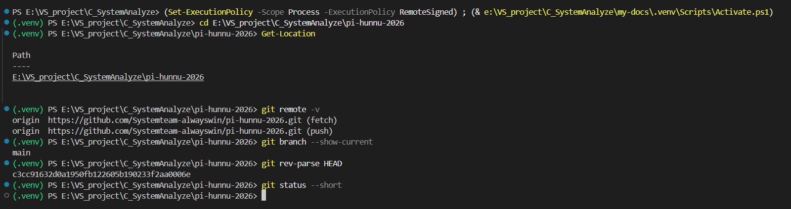
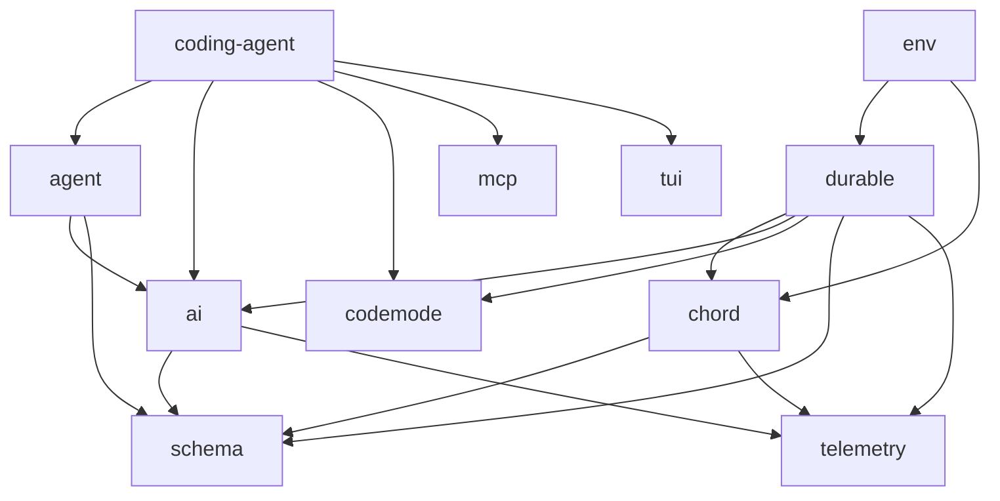

# 实践课2：组织建仓与源码分析

## 基本信息

- 姓名：魏铃峂霏
- 学号：202430071070
- GitHub 登录名：[4everik](https://github.com/4everik)
- 小组组织：Systemteam-alwayswin

## 一、源码获取

- 小组组织仓库（fork）：https://github.com/Systemteam-alwayswin/pi-hunnu-2026
- 本人 clone 命令：

```powershell
git clone --branch main https://github.com/Systemteam-alwayswin/pi-hunnu-2026.git
```

- 当前提交编号（`git rev-parse HEAD`）：`c3cc91632d0a1950fb122605b190233f2aa0006e`



## 二、模块分析

### 2.1 构建顺序

根目录 `package.json` 的 `scripts.build` 以串行命令固定了 11 个模块的构建顺序（被依赖的先构建）：

```
telemetry → schema → chord → tui → codemode → mcp → ai → durable → env → agent → coding-agent
```

### 2.2 模块分析表

| 子文件夹 | 代码主要实现什么功能 | 本模块 build 执行什么、生成什么 | 直接依赖哪些内部模块 | 依据文件或代码位置 |
|---|---|---|---|---|
| `telemetry` | 厂商中立的遥测契约与类型化 schema 工具：指标（metrics）、内存（memory）、渲染（render）、noop 空实现等，与具体后端解耦 | `tsc -p tsconfig.build.json`，把 `src/*.ts` 编译为 `dist/` | 无（叶子模块） | `packages/telemetry/package.json`、`src/{index,metrics,memory,render,noop}.ts` |
| `schema` | 无 eval 的 JSON Schema 校验库：支持 draft 2020-12 / draft-07，把 schema 编译成纯闭包校验器 | `tsc -p tsconfig.build.json` → `dist/` | 无（叶子模块） | `packages/schema/package.json`、`src/{compiler,validator,builders,checks,formats}.ts` |
| `chord` | 跨进程应用对象运行时：契约（contracts）、文档（documents）、store、links、热重载插件、HTTP、workers、web/终端客户端 | `tsc -p tsconfig.build.json` → `dist/` | `pi-schema`、`pi-telemetry` | `packages/chord/package.json`、`src/{contracts,documents,store,link,host,node,sqlite,sync}` |
| `tui` | 终端 UI 库：差分渲染，组件、keybindings、autocomplete、全屏搜索、latex 渲染等 | `tsc -p tsconfig.build.json` → `dist/`（另有 `build:native:*` 编译原生模块） | 无（叶子模块） | `packages/tui/package.json`、`src/{layout,components,keybindings,colors,native-*}.ts` |
| `codemode` | 沙箱化 JS 执行：唯一能力是调用注入的工具，基于 quickjs-wasi（WASM 版 QuickJS），让 AI 生成代码在受限环境运行 | `tsc -p tsconfig.build.json` → `dist/` | 无（叶子模块；外部依赖 `quickjs-wasi`） | `packages/codemode/package.json`、`src/{runtime,wasm,portable,cloudflare}.ts` |
| `mcp` | 独立 Model Context Protocol（MCP）客户端：client、transports、oauth、naming、protocol | `tsc -p tsconfig.build.json` → `dist/` | 无（叶子模块；外部依赖 `cross-spawn`） | `packages/mcp/package.json`、`src/{client,transports,oauth,protocol}.ts` |
| `ai` | 统一 LLM API：自动模型发现与提供商配置，聚合 Anthropic / AWS Bedrock / Google / OpenAI 等 SDK | `npm run generate-models && npm run build:offline`：先按 provider 数据生成模型目录，再 `check:model-data` + `tsc` 编译 + 复制 `src/providers/data` 到 `dist/providers` | `pi-schema`、`pi-telemetry` | `packages/ai/package.json`、`src/{api,providers,model-catalog,models.generated}.ts` |
| `durable` | Pi 的持久化对话/任务/文档运行时：session、task、document、storage、图片处理、工具搜索 | `tsc -p tsconfig.build.json` → `dist/`；其 tsconfig 用 `paths` 指向 `../chord/dist` 与 `../ai/dist` 的 `.d.ts` | `chord`、`pi-ai`、`pi-codemode`、`pi-schema`、`pi-telemetry` | `packages/durable/package.json`、`tsconfig.build.json`、`src/{session,tasks,documents,storage,images,tool-search}` |
| `env` | Pi Durable 的远程执行环境：经 SSH 部署的小型 daemon 及其 ExecutionEnv 客户端（ssh、terminal、remote-env、process、watch） | `tsc -p tsconfig.build.json` → `dist/` | `chord`、`pi-durable` | `packages/env/package.json`、`src/{ssh,terminal,remote-env,process,connection}.ts` |
| `agent` | 通用 agent 核心（pi-agent-core）：传输抽象、状态管理、附件支持（agent-loop、stream-fn、proxy） | `tsc -p tsconfig.build.json` → `dist/` | `pi-ai`、`pi-schema` | `packages/agent/package.json`、`src/{agent,agent-loop,proxy,types}.ts` |
| `coding-agent` | 编码 agent CLI：read / bash / edit / write 工具与会话管理，即最终面向用户的 `pi` 命令（bin: `pi`） | `npm run build:unbundled && node ../../scripts/build-coding-agent-bundle.mjs`：先 tsc 编译出非打包产物（给 cli.js/rpc-entry.js 加可执行权限 + copy-assets），再用 esbuild 打包成 `dist/bundle/cli.js` | `pi-agent-core`、`pi-ai`、`pi-codemode`、`pi-mcp`、`pi-tui` | `packages/coding-agent/package.json`、`src/{cli,main,core,modes,extensions}.ts` |

> 说明：文件夹名与 npm 包名不完全一致 —— `chord` → `@earendil-works/chord`（无 `pi-` 前缀）、`agent` → `@earendil-works/pi-agent-core`，其余为 `@earendil-works/pi-<folder>`。仓库里还有 `packages/evals`（评测包）不在本次 11 个模块与构建列表中。

### 2.3 模块层级与依赖关系图

箭头方向统一为「使用方 → 被依赖方」。图中连线均依据各模块 `package.json` 中 `dependencies` 写明的**运行时直接依赖**；经检查，11 个模块之间不存在内部的 `devDependencies` / `optionalDependencies` / `peerDependencies` 依赖，因此无需额外区分开发或可选依赖。



**层级划分依据**：按「依赖深度（离叶子模块的层数）」分层，被依赖最多的基础模块在底层：

| 层级 | 模块 | 说明 |
|---|---|---|
| L0 基础层 | `telemetry`、`schema`、`tui`、`codemode`、`mcp` | 无内部依赖的叶子模块，提供校验、遥测、终端渲染、沙箱执行、MCP 等基础能力 |
| L1 协议/模型层 | `chord`、`ai` | 依赖 L0 的 schema/telemetry，提供对象运行时与统一 LLM API |
| L2 运行时层 | `durable`、`agent` | 依赖 chord/ai 等，提供持久化运行时与 agent 核心循环 |
| L3 执行环境层 | `env` | 依赖 chord/durable，提供远程执行环境 |
| L4 应用层 | `coding-agent` | 顶层 CLI，组装 agent/ai/codemode/mcp/tui 成为 `pi` 命令 |

### 2.4 三个问题

**问题一：根目录与子模块中的 `npm run build` 分别读取什么配置、执行什么工作？**

- 根目录 `npm run build`：读取根 `package.json` 的 `scripts.build`（一条串行 shell 命令），依次 `cd packages/<模块> && npm run build`，按固定顺序构建 11 个模块。根目录本身不编译代码，只做「编排」。
- 子模块 `npm run build`：读取该模块自己 `package.json` 的 `scripts.build` 与 `tsconfig.build.json`。多数模块是 `tsc -p tsconfig.build.json`，把 `src/` 编译为 `dist/`（JS + `.d.ts` 类型声明）。两个例外：
  - `ai`：先 `generate-models` 根据 provider 数据生成模型目录，再 `check:model-data` + `tsc` 编译 + 复制 `src/providers/data` 模型 JSON 到 `dist/providers`。
  - `coding-agent`：先 `build:unbundled`（tsc 编译 + 加可执行权限 + copy-assets），再用 esbuild 打包出 `dist/bundle/cli.js`（即 `pi` 入口）。

**问题二：构建顺序和模块依赖有什么关系？相邻构建的模块是否一定互相依赖？**

构建顺序是**依赖关系的拓扑序**：被依赖的模块先构建，依赖它的模块后构建。例如 `chord` 依赖 `schema`/`telemetry`，所以这两者在前；`durable` 依赖 `chord`/`ai`/`codemode`/`schema`/`telemetry`，排在它们之后；`coding-agent` 依赖 `agent`/`ai`/`codemode`/`mcp`/`tui`，排在最后。`durable` 的 `tsconfig.build.json` 甚至用 `paths` 直接引用 `../chord/dist/*.d.ts` 和 `../ai/dist/index.d.ts`，证明编译 `durable` 时 `chord`、`ai` 必须先产出 `dist` 类型声明。

**相邻构建的模块不一定互相依赖**。例如 `tui → codemode → mcp` 三者依次构建，但彼此之间没有依赖（都是叶子模块）；`telemetry → schema` 相邻，但 `schema` 不依赖 `telemetry`。真正的约束是「依赖必须排在前面」，而不是「相邻必须依赖」。

**问题三：选择一条涉及至少三个模块的依赖路径，说明这些模块如何分工。**

以 `coding-agent → agent → ai → schema`（4 个模块）为例：

| 模块 | 分工 |
|---|---|
| `schema` | 数据契约的「标尺」：JSON Schema 校验（编译成闭包，无 eval），定义消息/配置/模型数据的合法结构 |
| `ai` | 与模型对话的「翻译官」：统一 LLM API，聚合多家提供商 SDK，负责请求/响应/模型发现；用 schema 校验配置与模型数据 |
| `agent`（pi-agent-core） | agent 的「大脑循环」：agent-loop、状态管理、附件、流式输出，调用 ai 与模型交互，用 schema 校验消息结构 |
| `coding-agent` | 面向用户的「外壳」：把 agent 核心 + read/bash/edit/write 工具 + TUI/会话管理拼装成 `pi` CLI |

分工上：`schema` 管「数据长什么样」→ `ai` 管「怎么和模型说话」→ `agent` 管「agent 循环与状态」→ `coding-agent` 管「怎么呈现给用户并接入编码工具」。

## 三、本人重点分析的模块

本次重点分析 `ai`、`durable`、`coding-agent` 三个模块：

- **`ai`（统一 LLM API）**：把 Anthropic / AWS Bedrock / Google / OpenAI 等多家提供商的 SDK 聚合到一个统一接口下，并内置模型目录（`models.generated.ts`）与模型发现机制。我的理解是它让上层（agent、coding-agent）不用关心具体用的是哪家模型，新增提供商只需在这一层改动，起到「隔离变化、依赖统一接口」的作用。
- **`durable`（持久化运行时）**：它是依赖最多的核心模块（依赖 chord、ai、codemode、schema、telemetry），负责会话 / 任务 / 文档的持久化、存储、图片处理与工具搜索。它把 AI 的交互结果变成可长期保存、可恢复的工作状态，是整个系统「记忆」的关键。
- **`coding-agent`（CLI 入口）**：最终面向用户的 `pi` 命令，把 agent 核心 + read / bash / edit / write 工具 + TUI / 会话管理组装起来，再用 esbuild 打包成单个可执行入口 `dist/bundle/cli.js`。它处在依赖最上层，本身不提供底层能力，扮演的是「组装者」角色。
