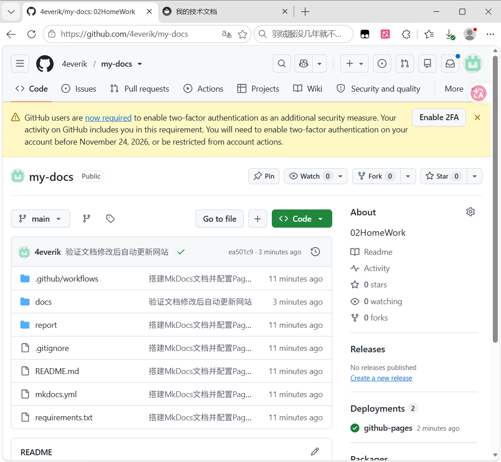
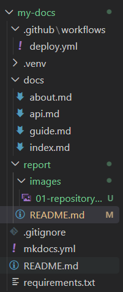
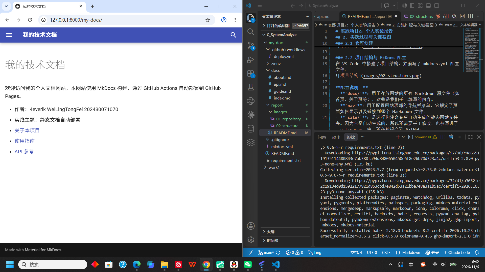
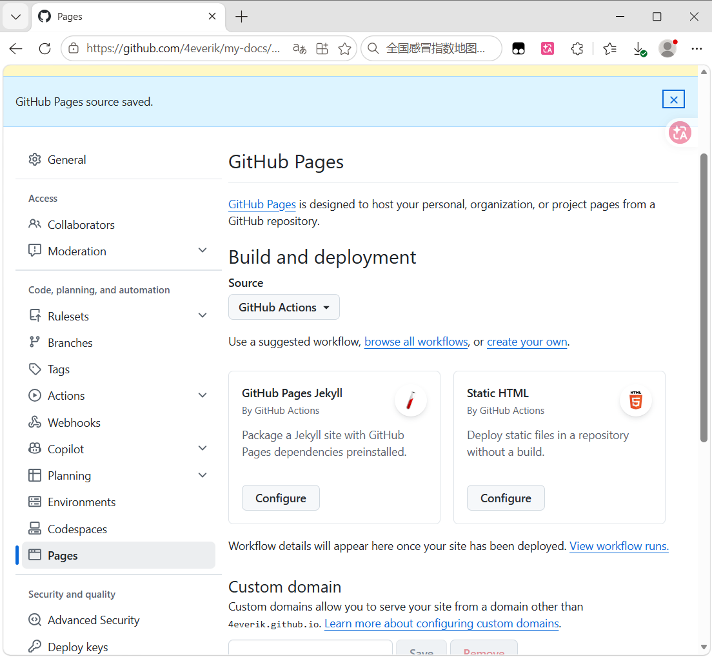
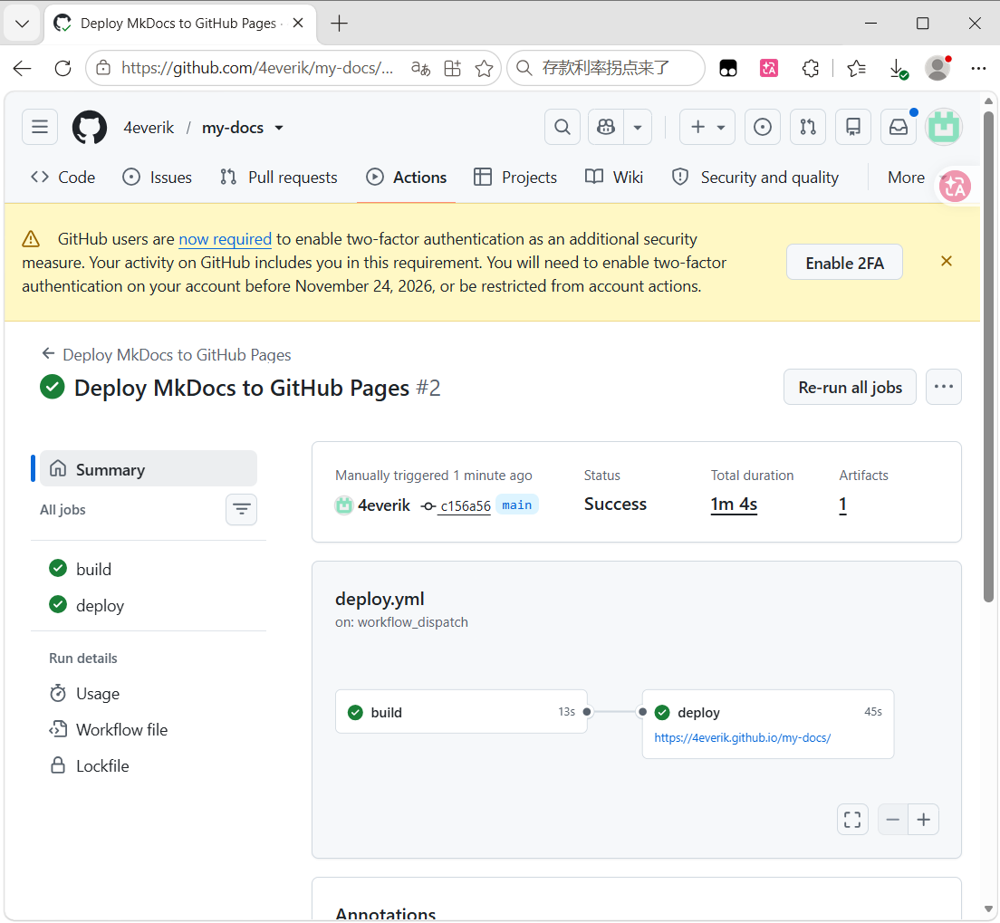
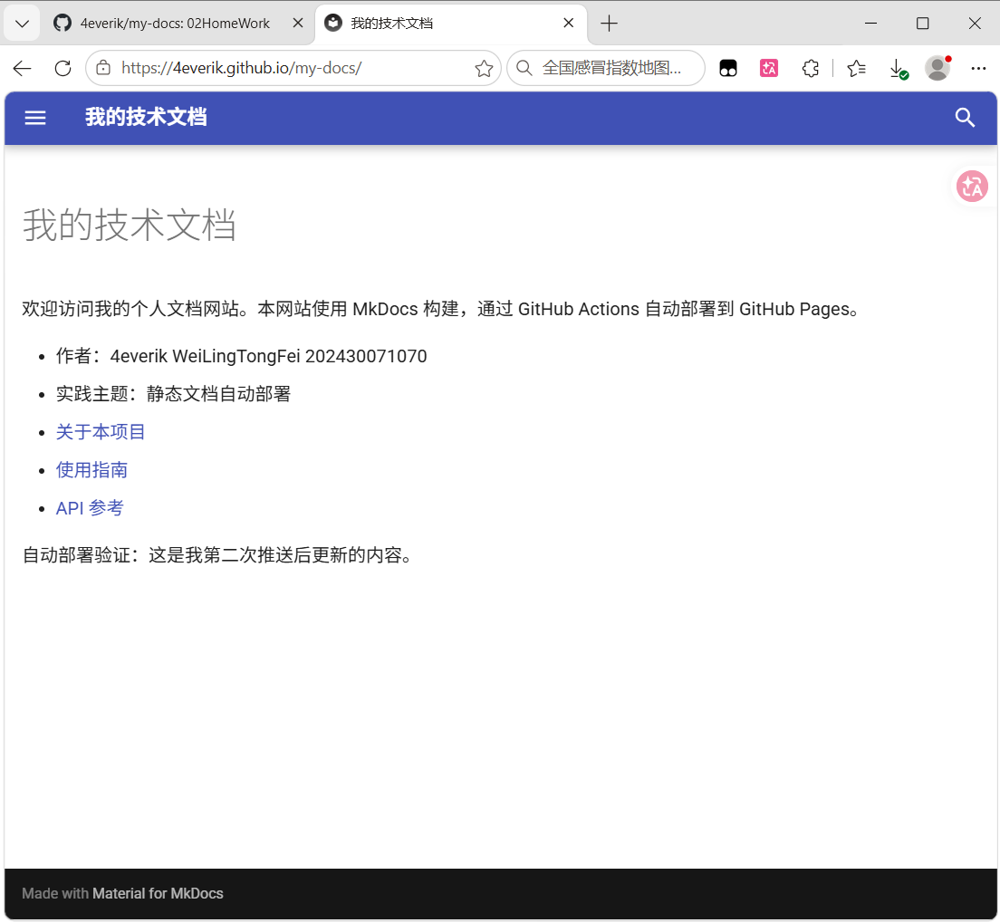
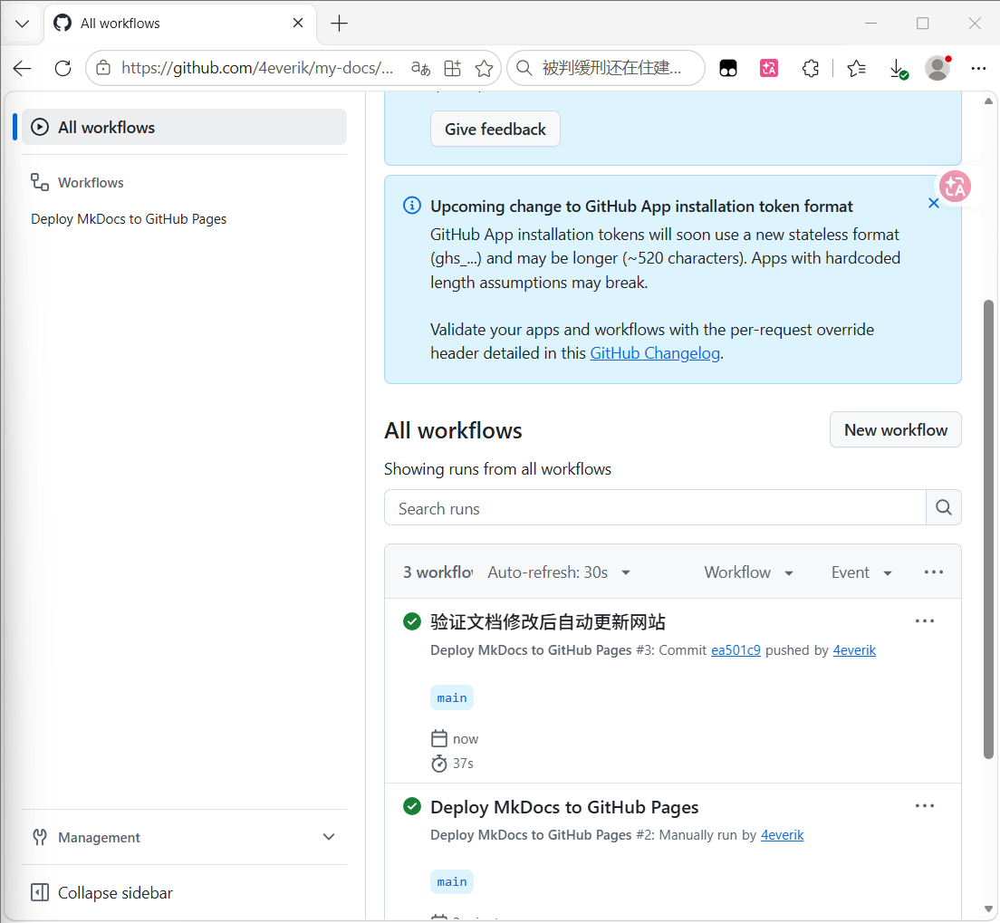
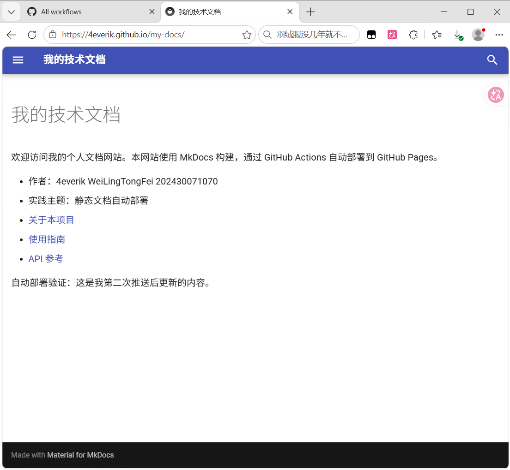

# 实践项目2：个人实验报告

## 1. 基本信息
- GitHub 登录名：4everik
- 个人仓库地址：https://github.com/4everik/my-docs
- 最终网站地址：https://4everik.github.io/my-docs/

## 2. 实践过程与关键截图

### 2.1 仓库创建
登录 GitHub，创建了公开仓库 my-docs，并克隆到本地。

### 2.2 项目结构与 MkDocs 配置
在 VS Code 中搭建了项目结构，并编写了 mkdocs.yml 配置文件。

**配置说明：**
- **`docs/`**：用于存放网站的所有 Markdown 源文件（如首页、关于页等），这些是我们手工编写的内容。
- **`nav`**：用于配置网站顶部的导航栏菜单，它规定了页面如何显示以及链接到哪个 Markdown 文件。
- **`site/`**：是运行构建命令后自动生成的静态网站文件夹。因为它是自动生成的，所以不需要手工修改，也被写进了 `.gitignore` 中，不会被提交到 GitHub。

### 2.3 本地构建或预览
通过 `python -m mkdocs serve` 在本地成功预览，终端显示 Serving on http://127.0.0.1:8000/my-docs/。
我逐个检查了“首页”、“关于”、“使用指南”和“API参考”四个页面，确认了顶部的导航栏可以正常跳转，Markdown 表格渲染正确，API 页面的代码块高亮正常。

### 2.4 Pages 设置
在仓库的 Settings -> Pages 中，将发布来源选择为 GitHub Actions。

### 2.5 Actions 首次构建和部署
配置了 `.github/workflows/deploy.yml`，首次推送后自动触发了工作流，build 和 deploy 均成功。

### 2.6 网站访问与四页导航检查
通过 GitHub Pages 提供的地址访问网站，确认四个页面导航正常。

### 2.7 第二次推送与自动更新验证
修改 `docs/index.md` 并再次推送，验证了自动部署功能。
- 对应提交链接：（在这里填入你仓库里提交记录的链接）
- 对应 Actions 运行链接：（在这里填入你 #3 运行记录的链接）

## 3. 问题与解决
在本地安装依赖时，由于网络原因下载失败，通过添加清华大学镜像源解决了依赖安装问题。在首次配置 GitHub Actions 时，因未提前将 Pages 来源设为 GitHub Actions 导致报错，后续在设置中调整后，重新运行成功。

## 4. 原理理解
1. **`docs/` 和 `site/` 各保存什么？为什么不用手工修改 `site/`？**
   `docs/` 保存的是源文件（Markdown），`site/` 是 MkDocs 构建生成的静态网站产物（HTML/CSS）。`site/` 是由工具自动生成的，每次改动源码都会重新覆盖，手工修改 `site/` 会在下次构建时丢失，且容易出错。
2. **本次工作流在什么情况下自动运行？**
   在推送代码到 `main` 分支，并且修改了 `docs/` 目录下的文件、`mkdocs.yml`、`requirements.txt` 或工作流文件时运行。也支持手动触发。
3. **build 与 deploy 两个任务有什么区别？**
   `build` 负责拉取代码、安装依赖并构建出 `site/` 产物；`deploy` 依赖 `build` 的成功运行，负责将产物正式发布到 GitHub Pages 环境。
4. **只修改 `report/README.md` 会触发部署吗？为什么？**
   不会。因为 `deploy.yml` 的 `paths` 配置限定了只有文档相关文件发生变动时才触发，这是为了节省资源，避免无关的修改（如修改报告）触发不必要的网站构建。
5. **本次方案为何无需创建 gh-pages 分支？**
   因为使用的是 GitHub 官方提供的 Actions 方案（`upload-pages-artifact` 和 `deploy-pages`），它直接将构建产物通过 Actions 上传并托管，无需像传统方案那样把产物推送到另一个专门的 `gh-pages` 分支。